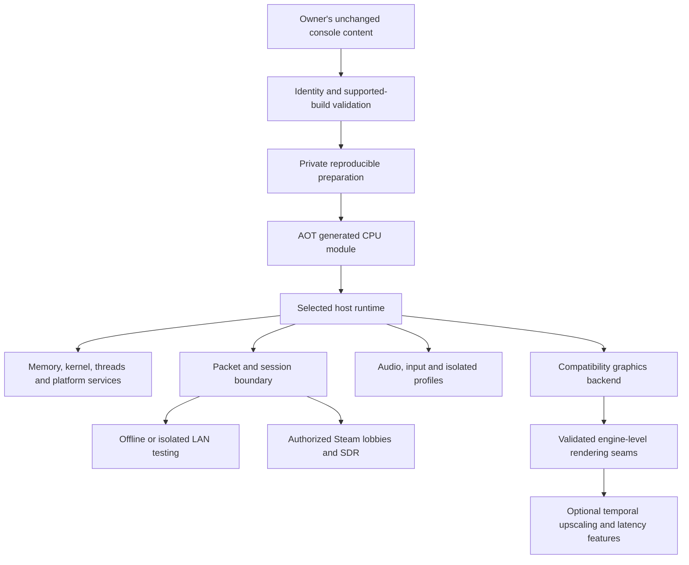

# Architecture decision: Xbox 360 AOT with selective native replacements

Status: direction accepted; runtime implementation choice is provisional until MW3-008. Optimization is part of selection, not an afterthought. No runnable MW3 runtime exists in this repository yet.

## Alternatives

| Approach | Fit for this team | Decision |
| --- | --- | --- |
| Full source reconstruction/decompilation | Maximum eventual control; very large recovery and behavioral-validation burden before an accurate whole game | Use selectively for interfaces and hot paths; do not make full recovery a prerequisite |
| Native PC executable modification | Existing native CPU execution; console split-screen and version-specific behavior may be absent or different; retains dependence on proprietary binaries | Optional reference/contingency, not the current product baseline |
| Xbox 360 static recompilation | Retains shipped gameplay and local-player code; significant kernel/GPU/audio/threading compatibility work remains | Preferred CPU execution path |
| PS3 recompilation | Cell/SPU and graphics work with less directly applicable technology from the requested references | Do not maintain a second console baseline |
| Emulator as product | Useful reference and differential oracle; different execution/performance/packaging tradeoffs from native AOT | Research/reference only |
| Hybrid AOT plus host runtime plus targeted native code | Preserves original logic while replacing platform services and measured bottlenecks | Chosen overall architecture |

The smallest maintainable product is one supported console build, one selected runtime and one graphics backend at first. Avoid building a generic console emulator, a new game engine, an abstraction around every upstream API, or parallel permanent renderers. Runtime selection compares MW2's related-title compatibility work with ReXGlue's shared runtime. Do not combine their memory layouts, PPC contexts or schedulers piecemeal.

## Intended boundaries

Only identity tools, the public test foundation and task tooling currently exist. The other boxes describe planned components.

### Preparation and executable identity

An original ISO is immutable input. Fingerprint disc, executable, revision/region and any separately supplied update. Extract private title inputs into ignored storage; do not patch originals. The preparation identity includes input hashes, toolchain/transitive dependency revisions, configuration, hooks and patches. SP and MP have separate generated outputs and address maps. Never infer an address from a similar title or human-readable filename. DLC and other regions require separate manifests and tests.

Ahead-of-time PPC translation uses analyzed functions and switch tables. Record undecoded instructions, indirect target misses, abnormal register flow and nonlocal exits. Start with conservative context/register behavior, then enable register locals, LTO/PGO or selective handwritten replacements using differential tests. An unresolved call is a diagnostic failure, not a successful stub.

### Runtime invariants

Keep guest pointers as explicitly sized big-endian addresses. One coherent guest address space must supply all CPU, GPU and audio views, including aliases and device MMIO. Test reservation versus commitment, 32-bit wrap, stack guards, physical-window coherence, allocator alignment and executable-range checks. Do not copy the related title's addresses or Windows mapping assumptions blindly.

Map guest threads, TLS/r13, synchronization, callbacks and lifecycle through the selected runtime's model. Preserve ordering and guest atomics; fewer host locks is not automatically correct. Use bounded waits with diagnostic capture, correct cancellation and clean shutdown. Avoid sleeps that only hide races. Profile scheduling and contention before changing affinity or spin policies.

Host services should use the runtime's proven platform abstraction. Prefer existing SDL support for windows/input/audio, isolation for saves and a bounded diagnostics seam. Keep test RPC local, authenticated where appropriate, and disabled from release builds. Read-only game content and writable profiles have distinct roots.

### Rendering and modernization

Begin with the selected runtime's compatibility backend to reach faithful output. Compare its GPU command path with an engine/D3D call seam only after captures and profiles exist. XenosRecomp is a shader translator, not a complete graphics runtime; its game-specific assumptions require validation. Unleashed provides useful examples of engine-aware pipeline prewarming and efficient native resource handling, not a renderer that can be renamed for MW3.

Shader caches key on content, translator/config revision, backend, device/driver compatibility and specialization state. Record cold versus warm runs. Do not hide compilation stutter by discarding first-run observations. Add asynchronous prewarm at known asset loading boundaries with bounded workers and correct resource lifetime. Cross-vendor behavior and split-screen VRAM matter alongside average FPS.

DLSS/DLAA requires usable depth, correct moving-object and camera vectors, jitter, exposure, view matrices, history resets and HUD separation for each viewport. Four local views must never share temporal history. If inputs cannot be reconstructed accurately, keep native/MSAA or an appropriate simpler enhancement. Frame generation and ray reconstruction are not baseline goals. Reflex requires verified simulation/render/present boundaries and measured latency, not just linked DLLs. SDK absence or unsupported hardware must preserve baseline rendering.

### Networking

Preserve original gameplay serialization first; replace transport/session services at a measured boundary. Separate Steam account identity from local guest slots. Authenticate a connection, verify lobby membership, negotiate protocol/content identity, rate/size bound traffic and only then admit packets to legacy parsers. Private friends-only lobbies are the initial online scope. Invites carry structured identifiers, never console commands.

Valve's public GameNetworkingSockets does not grant SDR service access. An authorized Steam AppID, relevant SDK permissions and an actual relay test are separate dependencies. Spacewar/another game's identity is not a production plan. CGNAT acceptance requires relayed connections with inbound ports/direct paths unavailable and two real households; local mocks cannot prove it. No transport can guarantee connectivity through every firewall or service outage. Keep offline operation and clear service failure messages.

### Four-player Survival extension

The owner's requested enhancement includes four local players, four online players, and feasible mixed local/remote combinations. First verify two-player retail behavior. Audit fixed-size arrays, scripts, AI targeting, spawn/revive/end conditions, profile/reward ownership, serialization, HUD/camera allocation and memory/CPU/GPU budgets. Preserve a two-player fallback. Scaling beyond two must pass both state and presentation tests; increasing a dvar alone is not acceptance. Balance changes beyond the minimum required scaling need an owner-facing creative decision.

## Selection and reconsideration

Use [the scorecard](research/scorecard.md). Correctness and licensing are pass/fail gates. Remaining weight: performance 30, stability 25, maintainability 20, integration effort 15, hardware compatibility 10. Unmeasured entries stay unknown. Compare a bounded identical MW3 slice, representative scenes and held-out cases. A larger performance win can justify migration; record migration cost and retirement of the prior path. Do not preserve an inefficient approach to defend an earlier plan.
